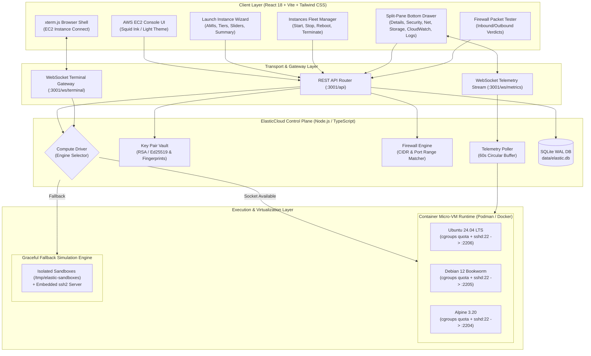
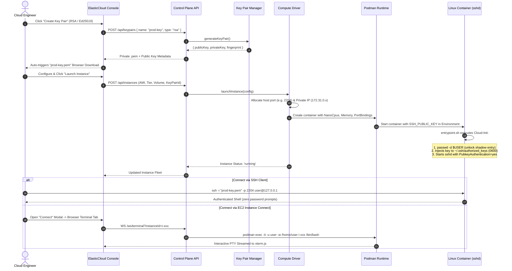
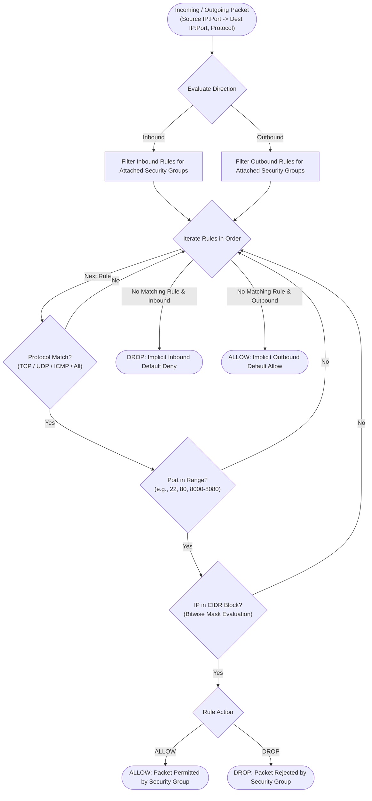

# ElasticCloud ☁️

> **Production-Grade AWS EC2 Cloud Console & Micro-VM Compute Orchestrator**

[](https://opensource.org/licenses/MIT)
[](https://nodejs.org/)
[](https://www.typescriptlang.org/)
[](https://react.dev/)
[](https://tailwindcss.com/)
[](https://podman.io/)

---

## 📑 Table of Contents

- [Overview](#-overview)
- [System Architecture](#-system-architecture)
  - [High-Level Architecture Diagram](#high-level-architecture-diagram)
  - [Instance Lifecycle & SSH Injection Sequence](#instance-lifecycle--ssh-injection-sequence)
  - [Security Group Packet Evaluation Flow](#security-group-packet-evaluation-flow)
- [Core Features](#-core-features)
  - [1. Multi-OS AMIs (Amazon Machine Images)](#1-multi-os-amis-amazon-machine-images)
  - [2. Configurable Sizing & Hardware cgroups Limits](#2-configurable-sizing--hardware-cgroups-limits)
  - [3. Cryptographic Key Pair Manager](#3-cryptographic-key-pair-manager)
  - [4. Zero-Setup EC2 Instance Connect (Browser Terminal)](#4-zero-setup-ec2-instance-connect-browser-terminal)
  - [5. Stateful Security Groups & Interactive Packet Simulator](#5-stateful-security-groups--interactive-packet-simulator)
  - [6. EBS Block Storage Engine](#6-ebs-block-storage-engine)
  - [7. CloudWatch-Style Live Telemetry & Inspector Drawer](#7-cloudwatch-style-live-telemetry--inspector-drawer)
- [REST & WebSocket API Reference](#-rest--websocket-api-reference)
- [Repository Structure](#-repository-structure)
- [Getting Started](#-getting-started)
  - [Prerequisites](#prerequisites)
  - [Quickstart Installation](#quickstart-installation)
  - [Building Base AMI Images](#building-base-ami-images)
- [Connecting to Instances](#-connecting-to-instances)
- [License](#-license)

---

## 🔭 Overview

**ElasticCloud** is a production-grade AWS EC2 Cloud Console and Compute Orchestrator clone. It delivers a high-density, pixel-perfect reproduction of the modern AWS EC2 Management Console (Squid Ink dark mode with AWS orange accents, collapsible navigation, split-pane inspector drawer, and launch wizard).

Under the hood, ElasticCloud provisions **real, isolated Linux micro-VM containers** using rootless Podman or Docker with enforced Linux cgroup hardware limits (`NanoCpus`, `Memory`, `MemorySwap`), OpenSSH servers, cloud-init key injection, virtual storage volumes, and real-time WebSocket terminal access (`xterm.js`). If the container engine is unavailable, ElasticCloud seamlessly transitions to an embedded **transparent simulation engine** with synthetic telemetry, boot logs, and simulated SSH daemons.

---

## 🏛 System Architecture

### High-Level Architecture Diagram



---

### Instance Lifecycle & SSH Injection Sequence



---

### Security Group Packet Evaluation Flow



---

## ⚡ Core Features

### 1. Multi-OS AMIs (Amazon Machine Images)
ElasticCloud provides 3 ready-to-launch, production-hardened operating system images:

| Operating System | AMI ID | Default User | Package Manager | Pre-installed Tooling |
| :--- | :---: | :---: | :---: | :--- |
| **Ubuntu 24.04 LTS (Noble Numbat)** | `ami-ubuntu2404` | `ubuntu` | `apt` | `openssh-server`, `sudo`, `iptables`, `iproute2`, `net-tools`, `procps` |
| **Debian 12 (Bookworm)** | `ami-debian12` | `debian` | `apt` | `openssh-server`, `sudo`, `iptables`, `iproute2`, `net-tools`, `procps` |
| **Alpine Linux 3.20** | `ami-alpine320` | `alpine` | `apk` | `openssh`, `sudo`, `iptables`, `iproute2`, `bash`, `shadow`, `procps` |

Each image features a tailored bootstrap cloud-init script (`entrypoint.sh`) that unlocks the user account in `/etc/shadow`, generates unique SSH host keys, injects the user's public key with strict `0600` permissions, grants passwordless `sudo` privileges, and runs `sshd` with explicit security overrides.

---

### 2. Configurable Sizing & Hardware cgroups Limits
Configure instances via AWS-style preset tiers or custom granular sliders:
- **Preset Sizing**: `t3.nano` (0.5 vCPU, 512 MB), `t3.micro` (1 vCPU, 1 GB), `t3.medium` (2 vCPU, 4 GB), `c6i.xlarge` (4 vCPU, 8 GB), `r6i.xlarge` (4 vCPU, 32 GB).
- **Custom Sliders**: Granularly configure from **0.5 to 16 vCPUs** and **256 MB to 32 GB RAM**.
- **Kernel Enforcement**: Enforced directly through container cgroups quotas (`NanoCpus` and `Memory` limits).

---

### 3. Cryptographic Key Pair Manager
Replicates the AWS EC2 Key Pair experience:
- **Generate Key Pairs**: Generate cryptographically secure **RSA 4096-bit** or **Ed25519** key pairs in OpenSSH format directly in the control plane.
- **Instant Browser Download**: Auto-triggers a client-side download of `<key-name>.pem`.
- **Import Key Pairs**: Paste and import existing `ssh-rsa` or `ssh-ed25519` public keys with instant SHA-256 fingerprint validation.

---

### 4. Zero-Setup EC2 Instance Connect (Browser Terminal)
Click **Connect** on any running instance to access two connection options:
1. **SSH Client Instructions**: Copy-pasteable SSH commands with dynamically assigned ports (`2201–2299`), key name, and host key verification helpers:
   ```bash
   chmod 400 my-key.pem
   ssh -i "my-key.pem" -p 2203 -o StrictHostKeyChecking=accept-new ubuntu@127.0.0.1
   ```
2. **EC2 Instance Connect**: Embedded browser terminal powered by `xterm.js` and WebSockets. Seamlessly attaches to the container's isolated shell via `podman exec` with full window resizing, ANSI colors, and command history.

---

### 5. Stateful Security Groups & Interactive Packet Simulator
- **Visual Rule Builder**: Configure Inbound and Outbound rules with type presets (`SSH`, `HTTP`, `HTTPS`, `Custom TCP`, `Custom UDP`, `All ICMP`), port ranges (`8000-8080`), and CIDR blocks (`0.0.0.0/0`, `10.0.0.0/8`, or "My IP").
- **Real-Time Packet Simulator**: Enter packet details (`Direction`, `Protocol`, `Source IP:Port`, `Destination IP:Port`) and receive an instant `ALLOWED` or `BLOCKED` verdict with matched rule details and rule explanations.

---

### 6. EBS Block Storage Engine
- **Volume Types**: `gp3` General Purpose SSD (baseline 3000 IOPS / 125 MB/s) and `io2` Provisioned IOPS SSD.
- **Configurable Capacity**: 8 GB to 500 GB virtual root volumes.
- **Termination Protection**: "Delete on Termination" toggle allows block volumes to persist after an instance is terminated.

---

### 7. CloudWatch-Style Live Telemetry & Inspector Drawer
Click any instance row in the fleet table to open an AWS-style resizable bottom drawer featuring 6 tabs:
1. **Details**: Metadata, AMI ARN, private/public IPs, and host port mappings.
2. **Security**: Active inbound and outbound firewall rules with color-coded port badges.
3. **Networking**: MAC address, private IPv4, and elastic network interface (`eni-xxx`) details.
4. **Storage**: Root block device (`/dev/sda1`), volume ID, IOPS, and throughput.
5. **Monitoring**: Live-updating area charts (Recharts) streaming real-time **CPU Utilization (%)**, **Memory Usage (MB)**, and **Network In/Out (KB/s)** via WebSockets.
6. **System Log**: Real-time console log viewer showing kernel boot logs, cloud-init output, and `sshd` connection events.

---

## 🔌 REST & WebSocket API Reference

### REST Endpoints (`http://localhost:3001/api`)

| Method | Endpoint | Description |
| :--- | :--- | :--- |
| `GET` | `/api/dashboard` | Get fleet statistics (vCPUs, RAM, running instances, volumes, keys) |
| `GET` | `/api/instances` | List all instances (supports `?state=running` filter) |
| `GET` | `/api/instances/:id` | Get instance metadata and state |
| `POST` | `/api/instances` | Launch a new instance (`LaunchInstanceRequest`) |
| `POST` | `/api/instances/:id/start` | Start a stopped instance |
| `POST` | `/api/instances/:id/stop` | Stop a running instance |
| `POST` | `/api/instances/:id/reboot` | Reboot an instance |
| `POST` | `/api/instances/:id/terminate` | Terminate an instance |
| `GET` | `/api/instances/:id/logs` | Fetch system and boot logs |
| `GET` | `/api/amis` | List available base AMIs (Ubuntu, Debian, Alpine) |
| `GET` | `/api/keypairs` | List all SSH key pairs and fingerprints |
| `POST` | `/api/keypairs` | Generate new RSA / Ed25519 key pair (returns private `.pem`) |
| `POST` | `/api/keypairs/import` | Import an existing public key |
| `DELETE` | `/api/keypairs/:id` | Delete a key pair |
| `GET` | `/api/security-groups` | List all security groups with rules |
| `POST` | `/api/security-groups` | Create a new security group |
| `PUT` | `/api/security-groups/:id` | Update security group details |
| `DELETE` | `/api/security-groups/:id` | Delete a security group |
| `POST` | `/api/security-groups/:id/rules` | Add an inbound/outbound rule |
| `DELETE` | `/api/security-groups/:id/rules/:ruleId` | Delete a firewall rule |
| `POST` | `/api/security-groups/test-packet` | Evaluate a packet against security group rules |
| `GET` | `/api/volumes` | List all EBS block volumes |

### WebSocket Channels (`ws://localhost:3001`)

- **`/ws/terminal?instanceId=:id`**: Interactive bidirection PTY stream (JSON resize events + raw terminal I/O).
- **`/ws/metrics?instanceId=:id`**: Live 5-second interval metric stream (CPU %, Memory MB, Network KB/s).

---

## 📂 Repository Structure

```text
ElasticCloud/
├── client/                          # React + TypeScript Frontend
│   ├── index.html                   # HTML Entry Point
│   ├── vite.config.ts               # Vite Configuration & API Proxy
│   ├── tailwind.config.js           # AWS Squid Ink / Dark Palette
│   └── src/
│       ├── api/client.ts            # Typed REST API Client
│       ├── components/
│       │   ├── common/              # Modal, SplitPane, Badge, Tabs, Table
│       │   ├── instances/           # InstanceTable, InstanceDetails, ConnectModal
│       │   ├── launch-wizard/       # LaunchWizard Configurator
│       │   ├── security-groups/     # SecurityGroupEditor, FirewallTester
│       │   ├── keypairs/            # KeyPairManager (.pem generator)
│       │   ├── terminal/            # WebTerminal (xterm.js integration)
│       │   └── monitoring/          # MetricsChart (Recharts CloudWatch telemetry)
│       └── pages/                   # DashboardPage, InstancesPage, AMIsPage, etc.
│
├── server/                          # Express + WebSocket Control Plane
│   ├── src/
│   │   ├── index.ts                 # Server Entry & WebSocket Setup
│   │   ├── db/                      # SQLite Database Layer (better-sqlite3)
│   │   ├── routes/                  # REST Route Handlers
│   │   ├── services/
│   │   │   ├── compute-driver.ts    # Podman/Docker Driver + Simulation Fallback
│   │   │   ├── key-manager.ts       # Cryptographic Key Generation & Fingerprinting
│   │   │   ├── firewall.ts          # CIDR Matching & Packet Simulator Engine
│   │   │   ├── telemetry.ts         # Resource Metrics Collection Service
│   │   │   └── simulated-sshd.ts    # Fallback In-Memory SSH Daemon
│   │   ├── websocket/               # Terminal & Telemetry WebSocket Handlers
│   │   └── docker/                  # Micro-VM Container Definitions
│   │       ├── entrypoint.sh        # Cloud-Init Bootstrap Script
│   │       ├── ubuntu.Dockerfile    # Ubuntu 24.04 LTS Base Image
│   │       ├── debian.Dockerfile    # Debian 12 Base Image
│   │       └── alpine.Dockerfile    # Alpine 3.20 Base Image
│   └── data/                        # Persistent SQLite Database (elastic.db)
│
├── shared/                          # Shared TypeScript Types & Constants
│   └── types.ts                     # Single Source of Truth
├── package.json                     # Monorepo Workspace Root
└── README.md                        # Documentation
```

---

## 🚀 Getting Started

### Prerequisites

- **Node.js**: `v20.x` or higher
- **Package Manager**: `npm`
- **Container Engine** *(optional, simulation fallback activates if absent)*:
  - **Podman** (rootless recommended) or **Docker Engine**

---

### Quickstart Installation

1. **Clone the repository:**
   ```bash
   git clone https://github.com/your-username/ElasticCloud.git
   cd ElasticCloud
   ```

2. **Install all dependencies:**
   ```bash
   npm run install:all
   ```

3. **Start both Backend and Frontend in development mode:**
   ```bash
   npm run dev
   ```

4. **Access the Console:**
   - **Frontend UI:** [http://localhost:3000](http://localhost:3000)
   - **Backend REST API:** [http://localhost:3001/api](http://localhost:3001/api)

---

### Building Base AMI Images

To enable real container micro-VMs, build the 3 base AMI images using Podman or Docker:

```bash
# 1. Build Ubuntu 24.04 LTS AMI
podman build -t elastic-ubuntu:24.04 -f server/src/docker/ubuntu.Dockerfile server/src/docker/

# 2. Build Debian 12 Bookworm AMI
podman build -t elastic-debian:12 -f server/src/docker/debian.Dockerfile server/src/docker/

# 3. Build Alpine Linux 3.20 AMI
podman build -t elastic-alpine:3.20 -f server/src/docker/alpine.Dockerfile server/src/docker/
```

---

## 🔑 Connecting to Instances

### Using Native SSH

1. Launch an instance with your generated or imported key pair.
2. In the **Instances** table, locate your assigned host port (e.g., `2203`).
3. Set permissions on your downloaded `.pem` file:
   ```bash
   chmod 400 my-key.pem
   ```
4. Connect using the appropriate user for your selected OS:
   ```bash
   # For Ubuntu:
   ssh -i "my-key.pem" -p 2203 -o StrictHostKeyChecking=accept-new ubuntu@127.0.0.1

   # For Debian:
   ssh -i "my-key.pem" -p 2203 -o StrictHostKeyChecking=accept-new debian@127.0.0.1

   # For Alpine:
   ssh -i "my-key.pem" -p 2203 -o StrictHostKeyChecking=accept-new alpine@127.0.0.1
   ```

> [!TIP]
> If a recycled local port triggers a `"REMOTE HOST IDENTIFICATION HAS CHANGED!"` warning, clear the old host key fingerprint with:
> ```bash
> ssh-keygen -R "[127.0.0.1]:2203"
> ```

---

### Using EC2 Instance Connect (Browser Terminal)

1. Select your running instance in the ElasticCloud console.
2. Click **Connect** in the top action toolbar.
3. Switch to the **EC2 Instance Connect (Browser)** tab.
4. An interactive shell will immediately open inside the container with passwordless `sudo` privileges.

---

## 🚢 Production Container Deployment

ElasticCloud is containerized and production-ready for **Docker, Docker Compose, AWS EC2, AWS ECS on Fargate, and Kubernetes**.

```bash
# Option 1: Docker Compose (Local or EC2)
docker compose up -d

# Option 2: Kubernetes (EKS / GKE / K3s)
kubectl apply -k k8s/

# Option 3: Automated AWS Fargate Deployment
./aws/deploy-fargate.sh
```

See **[DEPLOYMENT.md](DEPLOYMENT.md)** for detailed guides on AWS Fargate, EC2 Docker socket provisioning, EFS persistence, Kubernetes ingress/probes, and environment variables.

---

## 📜 License

This project is licensed under the **MIT License**.
